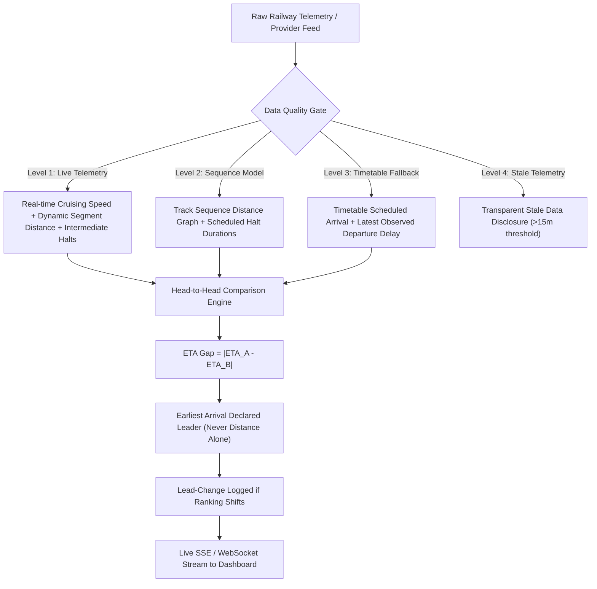

# 🚆 Which Train First — Indian Railway Head-to-Head Arrival Engine

> **Inspired by *"Where Is My Train"* — Don't just track trains in isolation. Predict which train will reach the destination first.**

<p align="center">
  <a href="https://github.com/Zakeer-official/which-train-first/stargazers"></a>
  <a href="https://github.com/Zakeer-official/which-train-first/network/members"></a>
  
  
  
  
  
  
</p>

---

## 🌟 The Problem & The Inspiration

**"Where Is My Train"** famously revolutionized how millions of Indian railway passengers answer one question:  
👉 *"Where is my train right now?"*

However, in real life, Indian railway travelers constantly face a different dilemma:

> **"My brother is traveling on Train 12656 (Navjeevan SF), and I am on Train 12705 (Gouthami SF). We are both meeting our family at Mahbubabad (MABD). Who will reach first? Should I book a cab now or wait for him?"**

Until now, answering this meant:
1. Opening tracking apps.
2. Checking Train 1's delay and station.
3. Switching to Train 2's screen and checking its delay and station.
4. Doing mental math comparing remaining distances, track halts, and delay propagation.
5. Guessing who will win.

**Which Train First** automates this entirely with a real-time head-to-head comparison engine, multi-level ETA physics, and instant WhatsApp race alerts.

---

## 🏁 Live Comparison Dashboard Preview

```text
┌────────────────────────────────────────────────────────────────────────────────────────────────────────┐
│  🏆 PREDICTED WINNER: Train 12656 (Navjeevan Superfast Express)                                        │
│  Arrival Margin: Predicted to reach Mahbubabad (MABD) 18 minutes earlier than Train 12705             │
│  Final Destination ETA: 02:24 AM  •  Current Delay: +18m (Recovering)  •  Confidence: 94%             │
└────────────────────────────────────────────────────────────────────────────────────────────────────────┘

  [ Train 1: 12656 Navjeevan Express ]              [ Train 2: 12705 Gouthami Express ]
  • Current Station: Warangal (WL)                  • Current Station: Kazipet (KZJ)
  • Cruising Speed: 82 km/h                         • Cruising Speed: 74 km/h
  • Delay: +18 min (Recovering)                     • Delay: +7 min (Steady)
  • Remaining to MABD: 60 km                        • Remaining to MABD: 70 km
  • Estimated Arrival: 02:24 AM                     • Estimated Arrival: 02:42 AM
  • Status: LEVEL 1 (Live GPS Telemetry)            • Status: LEVEL 1 (Live GPS Telemetry)
```

---

## 🧠 Multi-Level ETA Engine

Why simple distance calculation fails in railways:
- Railway tracks are divided into block sections with strict signaling priority.
- Superfast trains get priority over passenger/express services.
- Intermediate halts require deceleration, passenger boarding, and acceleration overhead.

**Which Train First** calculates ETAs through an explicit 4-level fallback hierarchy:



---

## 🚀 Key Features

- **Side-by-Side Dual Telemetry:** Desktop side-by-side and mobile stacked comparison cards.
- **Probabilistic AI Forecast Distribution (P10 / P50 / P90):** Eliminates naive deterministic arrival timestamps by calculating optimistic (P10), expected median (P50), and delayed worst-case (P90) confidence bounds, alongside timetable slack recovery calculations.
- **Outer Home Signal Clash Risk Predictor:** Detects platform congestion when competing trains approach within tight separation margins (<= 10 mins) and alerts passengers to high-probability outer signal detention.
- **Predicted Physical Overtake Station:** Scans upcoming route stops and cruise telemetry to identify the exact station where a faster trailing train will physically overtake a slower leader on a loop line.
- **Live Audio Track Commentary:** Built-in Web Speech synthesizer announcing live race updates and lead changes out loud like an authentic station track announcer.
- **Dynamic Common Destination Discovery:** Automatically analyzes the route stops of both trains and lists all shared upcoming stations (e.g. Mahbubabad, Vijayawada, New Delhi) for 1-click selection.
- **Interactive OpenStreetMap Leaflet Map:** Live GPS train coordinates, trajectory polylines, and common destination pin.
- **Dual-Rail Linear Convergence Tracker:** Real-time visual progress bar showing both trains racing along the track towards the common destination station.
- **Recharts Delay Variance Graphs:** Live trendline tracking whether trains are recovering lost time or losing margin.
- **Lead-Change Event Log:** Automatically logs timestamped notifications whenever a trailing train overtakes the leader.
- **Installable Mobile PWA:** Includes a web app manifest (`manifest.json`) enabling standalone installation on Android and iOS devices.
- **One-Click WhatsApp Sharing:** Generates a public link with prefilled WhatsApp message requiring **no user login or app installation** for the recipient.

---

## 🛠️ Technology Stack

| Layer | Technologies |
| :--- | :--- |
| **Frontend** | Next.js 14 (App Router), TypeScript, Tailwind CSS, Lucide React, Recharts, Leaflet / OpenStreetMap |
| **Backend** | Python 3.12, FastAPI, Pydantic V2, Pydantic Settings, SQLAlchemy (Async), Uvicorn |
| **Database** | SQLite + `aiosqlite` for local dev; PostgreSQL ready for production |
| **Cache** | In-memory TTL caching + Redis extension |
| **Testing** | Pytest, `pytest-asyncio`, HTTPX (10 automated tests with 100% pass rate) |
| **DevOps** | Docker, Docker Compose, GitHub Actions |

---

## 📁 Repository Structure

```text
which-train-first/
├── backend/
│   ├── app/
│   │   ├── main.py                  # FastAPI application & lifespan management
│   │   ├── config.py                # Environment configuration
│   │   ├── database.py              # Async SQLAlchemy database engine
│   │   ├── models/                  # Train, Station, RaceSession, Snapshots, LeadChanges
│   │   ├── schemas/                 # Pydantic schemas for data validation
│   │   ├── providers/               # Abstract Provider, High-fidelity Demo, RapidAPI
│   │   ├── engine/                  # ETACalculator & TrainComparisonEngine
│   │   ├── api/                     # REST endpoints: trains, stations, races, health
│   │   └── services/                # Caching & race session management
│   ├── tests/                       # 10 automated unit & integration tests
│   └── requirements.txt
├── frontend/
│   ├── src/
│   │   ├── app/                     # Next.js 14 App Router
│   │   │   ├── page.tsx             # Landing Page with Hero & Recent Races
│   │   │   ├── create/page.tsx      # Create Race with Auto-Destination Discovery
│   │   │   ├── race/[id]/page.tsx   # Live Race Dashboard
│   │   │   └── about/page.tsx       # Data Sources, Health & Methodology
│   │   ├── components/              # TrainCard, RaceLeaderBanner, Map, Charts, Tracker
│   │   └── lib/                     # API client & TypeScript interfaces
│   └── package.json
├── docker-compose.yml               # Containerized full-stack deployment
├── .env.example                     # Environment variables template
├── PROJECT_STATUS.md                # Task tracking & verification checklist
└── README.md                        # Documentation
```

---

## 💻 Getting Started Locally

### 1. Clone the Repository
```bash
git clone https://github.com/Zakeer-official/which-train-first.git
cd which-train-first
```

### 2. Run Backend
```bash
cd backend
python -m venv venv

# Windows:
.\venv\Scripts\activate
# Linux / macOS:
source venv/bin/activate

pip install -r requirements.txt greenlet

# Run automated tests
$env:PYTHONPATH = "."
pytest -v

# Start FastAPI server
uvicorn app.main:app --reload --port 8000
```
*Interactive Swagger API documentation: [http://localhost:8000/docs](http://localhost:8000/docs)*

### 3. Run Frontend
In a separate terminal:
```bash
cd frontend
npm install
npm run dev
```
*Open application: [http://localhost:3000](http://localhost:3000)*

---

## 🐳 Docker Deployment

Run both backend and frontend in isolated containers:
```bash
docker-compose up --build
```

---

## ⭐ Support & Community

If you find this concept innovative or useful for Indian Railway travelers:
- ⭐ **Star this repository** to help others discover it!
- 🔀 **Fork & Contribute:** PRs for new station coordinates, additional railway data adapters, and UI enhancements are welcome.
- 💬 **Share with fellow travelers** on WhatsApp, Twitter/X, and Reddit!

---

<p align="center">
  <b>Which Train First</b> • Built with ❤️ for Indian Railway Commuters
</p>
